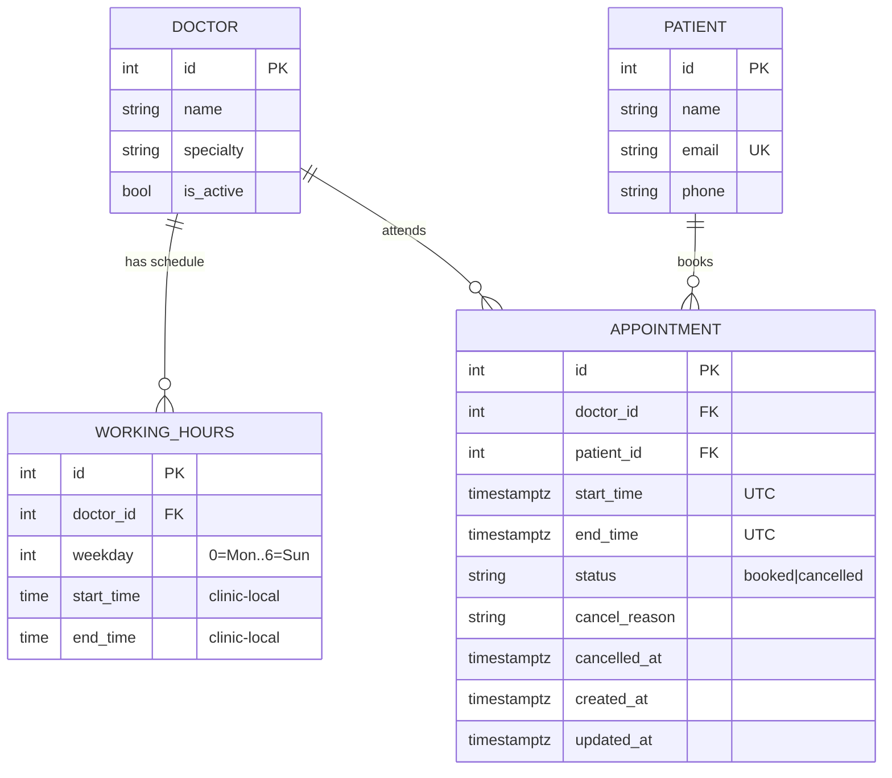

# Clinic Booking API

REST API for a small clinic (5 doctors, 30-minute slots) to let patients view free slots, book, cancel and reschedule.

> **Status:** Day 1 complete (design, models, migration, seed, schema tests).
> Endpoints, deployment and CI/CD follow. Sections marked _TODO_ are filled in as they're built.

| | |
|---|---|
| **Live URL** | _TODO (Section 3)_ |
| **API docs** | _TODO_ `<live-url>/docs` |
| **Stack** | Python 3.12, FastAPI, SQLAlchemy 2.0, Alembic, PostgreSQL, pytest, GitHub Actions |

---

## 1. System design

### 1.1 Requirements I extracted from the brief

| From the brief | What it means for the design |
|---|---|
| "5 doctors … set working hours" | Per-doctor, per-weekday schedules (not one global clinic schedule) |
| "30-minute slots" | A fixed slot grid derived from working hours |
| "see which slots are free … pick one … book it" | A read model (availability) and a write model (booking) |
| "Once booked, that slot must not be available to others" | **Concurrency-safe** uniqueness; two people clicking at once must not both win |
| "Patients should also be able to cancel" | Cancellation frees the slot; keep history |
| "Starting small but want to grow" | Simple now, with explicit seams for growth (see 1.6) |

### 1.2 Entities



### 1.3 Components (layering)

```
HTTP (FastAPI routers)      validation of input shape, status codes, error format
        |
Service layer               booking rules: working hours, past, lead time, alignment
        |                   (pure functions where possible so they are unit-testable)
Persistence (SQLAlchemy)    models + the DB constraint that is the final line of defence
        |
PostgreSQL
```

Planned layout: `app/routers/`, `app/services/` (booking + slot generation), `app/schemas/` (Pydantic), `app/models.py`, `app/config.py`.
Keeping the rules in a service layer (not in route functions) means the same logic backs both `POST /appointments` and `PATCH .../reschedule`, so the two can never drift apart.

### 1.4 Key decisions and trade-offs

**D1. Compute slots on the fly instead of storing slot rows.**
Availability = (working-hour blocks cut into 30-min pieces) minus (active appointments).
- *Why:* five doctors, tiny data; no background job to "generate slots"; changing a doctor's hours takes effect immediately with nothing to backfill.
- *Trade-off:* can't attach per-slot metadata (blocked, holiday, overbook) without extra tables.
- *Alternative considered:* a pre-materialised `slots` table with a `booked` flag. Simpler queries and per-slot overrides, but needs a generator job, goes stale when hours change, and creates a second source of truth that can disagree with appointments.
- *Growth path:* add a `schedule_exceptions` table (holidays, leave) and/or materialise slots when overrides become common.

**D2. Double-booking is prevented by the database, not by application code.**
A *partial unique index* on `appointments(doctor_id, start_time) WHERE status = 'booked'`.
- *Why:* a "check if free, then insert" in Python has a race: two requests both see the slot as free and both insert. Only the database can atomically arbitrate. The loser gets a unique-violation which the API maps to **409 Conflict**.
- *Verified:* 10 simultaneous inserts for one slot against real PostgreSQL → 1 succeeds, 9 rejected (see `tests/test_schema.py` and the concurrency test added with the API).
- *Why partial:* cancelled rows are exempt from the index, so cancelling instantly frees the slot **and** we keep the cancelled row as history/audit. No deleting, no flag juggling.
- *Trade-off:* the index guards identical start times, which is sufficient only because every appointment is aligned to the 30-minute grid and has fixed length. If durations ever vary, switch to a PostgreSQL **exclusion constraint** (`EXCLUDE USING gist (doctor_id WITH =, tstzrange(start_time, end_time) WITH &&) WHERE (status='booked')`), which blocks any *overlap*. I chose the simpler index because it also works on SQLite for fast tests, and the exclusion constraint isn't needed for fixed-length slots.
- *Alternatives considered:* row locking (`SELECT … FOR UPDATE`) — needs a row to lock when the slot doesn't exist yet; an advisory lock — works but is hidden behaviour a reader must discover. The constraint is declarative and visible in the schema.

**D3. Timezones: store UTC, define schedules in clinic-local time.**
- Instants (`start_time`, `end_time`) are `timestamptz` in UTC. Working hours are wall-clock `time` values interpreted in `CLINIC_TIMEZONE` (default `Africa/Nairobi`).
- *Why:* "9am" must mean 9am in Nairobi no matter where the server runs. Storing wall-clock for schedules and UTC for events avoids both server-locale bugs and DST bugs if the clinic ever moves/expands to a DST region.
- API accepts ISO-8601 timestamps with an offset and rejects naive datetimes (ambiguous).
- *Trade-off:* a single clinic timezone for now. Multi-clinic would put a `timezone` column on a `clinics` table.

**D4. Statuses as a string + CHECK constraint, not a native enum.**
Native PostgreSQL enums are painful to alter in migrations. A CHECK-constrained string is just as safe and trivially extendable (`completed`, `no_show` later).

**D5. Cancellation is a status change, never a delete.**
A `CHECK` ensures a cancelled row always has a `cancel_reason` (the brief requires a reason), enforced in the DB so no code path can skip it. History is preserved for audit and analytics.

**D6. Reschedule = update the same appointment in one transaction.**
The row's `start_time/end_time` move; the old slot frees automatically (the index only sees the new time). The new time goes through the *same* validator as a fresh booking. If the new slot is taken the transaction rolls back and the appointment stays where it was; the patient never loses their original slot. Keeping the same ID preserves history.

**D7. Alembic migrations, not `create_all()`.**
Schema changes are versioned and reviewable, the deploy pipeline runs `alembic upgrade head`, and CI checks the migration matches the models (`alembic check`) so they can't silently drift.

**D8. Auth is out of scope.**
The brief doesn't mention it. Patients are identified by `patient_id` in the request. This is a deliberate shortcut: in production, `patient_id` would come from a verified token (not the request body), otherwise anyone could cancel anyone's appointment. See "What I'd do next".

### 1.5 Business rules (the contract the API will enforce)

| Rule | Status code |
|---|---|
| Doctor / patient / appointment not found | `404` |
| Start time not on a `:00`/`:30` boundary | `422` |
| Slot outside the doctor's working hours (slot must **fully fit** in a block) | `422` |
| Slot in the past | `422` |
| Slot within `MIN_LEAD_MINUTES` of now (bonus; default 60) | `422` |
| Slot already booked (incl. lost a race) | `409` |
| Cancelling an already-cancelled appointment | `409` |
| Rescheduling a cancelled appointment | `409` |
| Malformed date / naive datetime | `422` |

All errors share one shape: `{"detail": "human readable", "code": "SLOT_TAKEN"}` so clients can branch on `code`.

### 1.6 Designed for growth (without building it yet)

| Future need | Seam already in place |
|---|---|
| Holidays / doctor leave | Add `schedule_exceptions`; slot generator subtracts them |
| Variable appointment length | Swap unique index for the exclusion constraint (D2) |
| More clinics | Add `clinic_id` + per-clinic timezone |
| Heavy read traffic on availability | Cache per `(doctor, date)`; invalidate on booking/cancel; add a read replica |
| Reminders / notifications | Emit an event on booking/cancel to a queue (the service layer is the single place to do it) |
| Auth & roles | FastAPI dependency injects the current user; endpoints stop trusting `patient_id` |

---

## 2. Assumptions made where the brief was ambiguous

1. **One continuous appointment = one 30-minute slot.** No multi-slot bookings.
2. **A slot must fully fit** inside working hours: with hours ending at 17:00, 16:30 is bookable, 16:45 is not.
3. **Working hours can have several blocks per day** (e.g. lunch break) and a doctor with no rows for a weekday doesn't work that day.
4. **Start times must align to :00 or :30.**
5. **Lead time (bonus):** bookings *and reschedules* must start at least 60 min from now (configurable via `MIN_LEAD_MINUTES`).
6. **Rescheduling to the same slot** is rejected (nothing to do).
7. **Cancelled slots are bookable again** by anyone, including the same patient.
8. **Patients/doctors are seeded**; there are no create endpoints (not in the required list). `scripts/seed.py` creates 5 doctors and 3 demo patients.
9. **Past/lead-time checks use "now" in UTC** and are compared as instants, so timezone of the client doesn't matter.

---

## 3. Run locally

```bash
# 1. Start Postgres
docker compose up -d db

# 2. Install & configure
python -m venv .venv && source .venv/bin/activate
make install
cp .env.example .env

# 3. Create schema + demo data
make migrate
make seed

# 4. Run
make run                 # http://localhost:8000/docs
```

Or everything in containers: `docker compose up --build`.

**Tests / quality:**
```bash
make test     # pytest + coverage (uses in-memory SQLite, no setup needed)
make lint     # ruff + mypy
```

---

## 4. API summary

All endpoints return timestamps with explicit clinic offset (`+03:00`, `Africa/Nairobi`). Error responses adhere to the standard shape: `{"detail": "...", "code": "MACHINE_CODE"}`.

| Method | Endpoint | Description | Status Codes |
|---|---|---|---|
| `GET` | `/health` | Service health & liveness check | `200` |
| `GET` | `/doctors` | List active doctors | `200` |
| `GET` | `/doctors/{id}/availability?date=YYYY-MM-DD` | Dynamic free 30-min slots for a given date | `200`, `404` |
| `POST` | `/appointments` | Book a consultation slot | `201`, `404`, `409`, `422` |
| `GET` | `/appointments/{id}` | Get appointment status & history | `200`, `404` |
| `PATCH` | `/appointments/{id}/cancel` | Cancel an appointment with a reason | `200`, `404`, `409`, `422` |
| `PATCH` | `/appointments/{id}/reschedule` | Move appointment to a new slot in one transaction | `200`, `404`, `409`, `422` |
| `GET` | `/patients/{id}/appointments` | Upcoming active appointments for a patient | `200`, `404` |

---

## 5. CI/CD & Shipping Standards

### 5.1 Neon PostgreSQL
The Neon project configuration is in [`neon.ts`](neon.ts). `neon deploy` writes connection
settings to `.env.local`; that file is ignored by Git and loaded by the app. The API uses
`DATABASE_URL` for pooled application traffic. Alembic prefers `DATABASE_URL_UNPOOLED` for
schema migrations, as Neon requires a direct connection for migration tooling. Keep both
values private and configure them as deployment secrets outside local development.

Run `npm run build` for the Python source compilation check and `alembic upgrade head` to
apply schema migrations to the configured database.

### 5.2 Branching Strategy & Environments
The repository follows a multi-tier branching and deployment workflow:
- `feature/*` & `fix/*`: Developer working branches created from `staging`. All non-emergency work happens here.
- `staging`: Integration and pre-production branch. Features are merged into `staging` via Pull Requests.
  - Automatically triggers CI quality checks.
  - Builds and publishes container images tagged `staging` (`ghcr.io/taliano008/clinic-booking-api:staging`) and commit SHA.
  - Serves as the candidate for staging QA and verification before production.
- `main`: Production release branch. Merged strictly from `staging` via PR (or critical `hotfix/*` branches).
  - Strictly protected against direct commits or unverified merges.
  - Automatically builds and publishes container images tagged `latest` (`ghcr.io/taliano008/clinic-booking-api:latest`) and commit SHA.

```
feature/xyz  ──PR──>  staging (pre-prod / tests / :staging)  ──PR──>  main (production / :latest)
                             ^
                             | (sync)
hotfix/fix   ────────────────┴─────────────────────────────────PR──>  main
```

### 5.3 Continuous Integration & Deployment Pipeline
Configured in [`.github/workflows/ci.yml`](.github/workflows/ci.yml):
1. **Automated Quality Checks (CI):**
   - Triggers on pull requests and pushes to `main` and `staging`.
   - Spins up a real PostgreSQL 16 Alpine container with health checks.
   - Code style and formatting verification (`ruff check . && ruff format --check .`).
   - Strict static type checking (`mypy`).
   - Migration integrity verification (`alembic upgrade head && alembic check`).
   - Test suite with code coverage threshold (`pytest --cov --cov-report=term-missing`).
2. **Container Build & Registry Publishing (CD):**
   - Automatically executes on pushes to `main` and `staging` after test suite succeeds.
   - Builds Docker image with Buildx layer caching.
   - Publishes tagged container images to GitHub Container Registry:
     - On `main`: `ghcr.io/taliano008/clinic-booking-api:latest` + SHA
     - On `staging`: `ghcr.io/taliano008/clinic-booking-api:staging` + SHA

### 5.4 Branch Protection Configuration Guide (GitHub Repository Settings)
Branch protection must be configured in GitHub (**Settings > Branches > Add branch protection rule** or **Settings > Rulesets**):

#### 1. Protection for `main` (Production - Strict)
- **Branch name pattern:** `main`
- **Protect matching branches:**
  - [x] **Require a pull request before merging**
    - [x] Require approvals: at least **1** approving review
    - [x] Dismiss stale pull request approvals when new commits are pushed
  - [x] **Require status checks to pass before merging**
    - [x] Require branches to be up to date before merging (`Strict`)
    - Status check name: `Run Tests & Quality Checks`
  - [x] **Require conversation resolution before merging**
  - [x] **Do not allow bypassing the above settings** (enforce for administrators)
  - [x] **Block force pushes** (disallow `git push --force`)
  - [x] **Block branch deletion**

#### 2. Protection for `staging` (Integration)
- **Branch name pattern:** `staging`
- **Protect matching branches:**
  - [x] **Require a pull request before merging**
  - [x] **Require status checks to pass before merging**
    - Status check name: `Run Tests & Quality Checks`
  - [x] **Require conversation resolution before merging**
  - [x] **Block force pushes** (disallow `git push --force`)
  - [x] **Block branch deletion**


## 6. AI reflection
_TODO (Day 5)_. Written from my running notes in [`docs/ai-log.md`](docs/ai-log.md).

## 7. What I'd do next
- Authentication/authorisation (patients can only act on their own appointments)
- Schedule exceptions (holidays, leave)
- Exclusion constraint if appointment lengths vary
- Availability caching, rate limiting, structured logging and metrics
